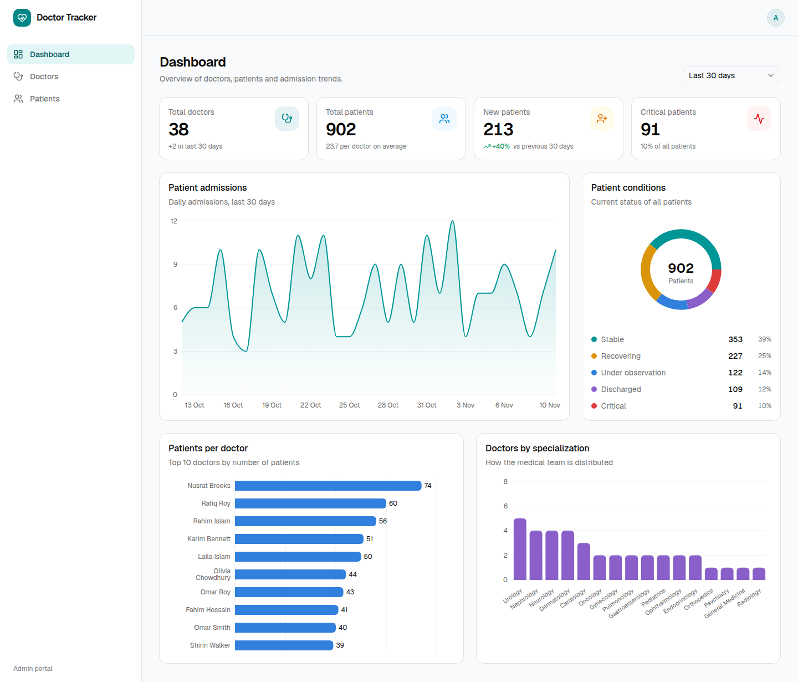
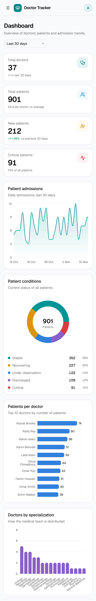
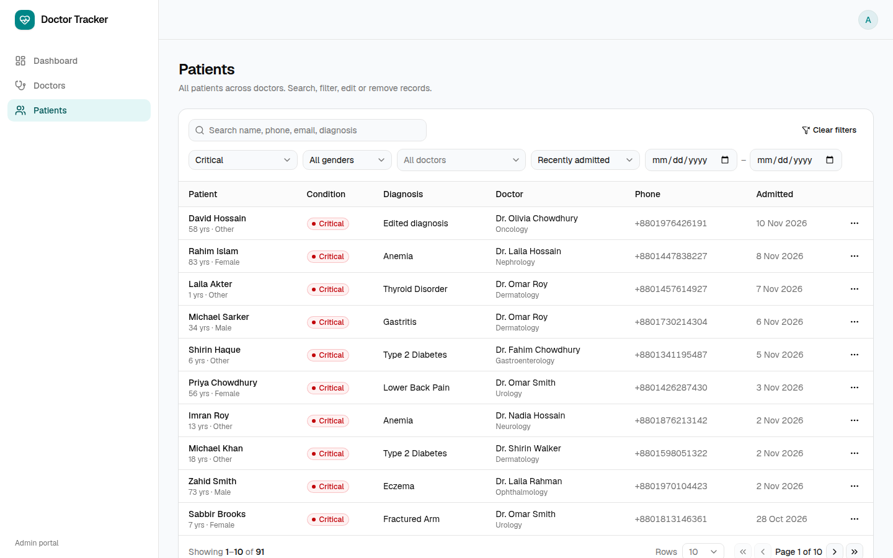
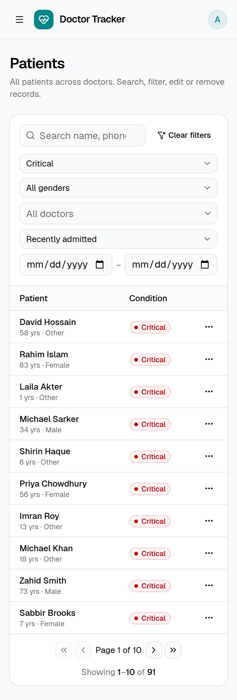

# Doctor Tracker — REST API

> Express + MongoDB API powering the Doctor Tracker admin portal.
> Frontend repository: **[doctor-tracker-frontend](https://github.com/bdalomgir/doctor-tracker-frontend)**

| | |
|---|---|
| **Live API** | [https://doctor-tracker-backend.alomgir.me](https://doctor-tracker-backend.alomgir.me/health) (health check: `/health`) |
| **API docs (Swagger)** | [https://doctor-tracker-backend.alomgir.me/api-docs](https://doctor-tracker-backend.alomgir.me/api-docs) |
| **Live app** | [doctor-tracker-frontend-ivory-zeta.vercel.app](https://doctor-tracker-frontend-ivory-zeta.vercel.app) |
| **Demo login** | `admin@doctortracker.com` / `Admin@12345` |

## Description

Doctor Tracker is a secure administrative web application that lets hospital and clinic administrators manage doctors and their patients and understand their caseload through analytics. This repository is its standalone REST API: it authenticates administrators with JWTs in httpOnly cookies, validates every request, and serves fast, index-backed search, filtering and pagination over doctors and patients, plus aggregated dashboard statistics (totals, patients per doctor, condition mix, specialization coverage and time-zone-aware daily admissions).

## Tech stack

Node.js 20 · Express 5 · TypeScript · MongoDB + Mongoose 8 · Zod · JSON Web Tokens · bcrypt · helmet · express-rate-limit

## Setup Guide

**Prerequisites:** Node.js ≥ 20 and MongoDB 6+ (local install or a free [MongoDB Atlas](https://www.mongodb.com/atlas) cluster).

```bash
# 1. Clone and install
git clone https://github.com/bdalomgir/doctor-tracker-backend.git
cd doctor-tracker-backend
npm install

# 2. Configure environment
cp .env.example .env            # set MONGODB_URI and a long random JWT_SECRET

# 3. Create the admin user (+ optional demo data: 36 doctors, 900 patients)
npm run seed                    # admin only
npm run seed -- --demo          # admin + demo data (replaces doctors & patients)

# 4. Run
npm run dev                     # http://localhost:5000
```

### Environment variables (`.env.example`)

| Variable | Description | Default |
|---|---|---|
| `NODE_ENV` | `development` / `production` | `development` |
| `PORT` | HTTP port | `5000` |
| `HOST` | Interface to bind (`127.0.0.1` behind nginx) | `0.0.0.0` |
| `MONGODB_URI` | MongoDB connection string | — (required) |
| `JWT_SECRET` | Token signing secret, ≥ 32 chars (`openssl rand -hex 32`) | — (required) |
| `JWT_EXPIRES_IN_HOURS` | Session lifetime (JWT and cookie) | `24` |
| `CORS_ORIGINS` | Comma-separated origins allowed to call the API from a browser (the web app's URL) | `http://localhost:3000` |
| `SEED_ADMIN_NAME` / `_EMAIL` / `_PASSWORD` | Admin created by `npm run seed` | `Admin` / `admin@doctortracker.com` / `Admin@12345` |

Environment variables are validated with Zod at boot; the process exits with a clear message if any is missing or invalid.

### Scripts

| Command | Purpose |
|---|---|
| `npm run dev` | Start with hot reload (tsx) |
| `npm run build` / `npm start` | Compile to `dist/` / run compiled server |
| `npm run seed [-- --demo]` | Sync indexes, create admin, optionally load demo data |
| `npm run lint` · `npm run typecheck` · `npm run format` | ESLint · TypeScript · Prettier |

### Deployment

The live API runs on an Ubuntu VPS:

```
Internet ─► nginx (TLS via Let's Encrypt) ─► PM2: node dist/server.js on 127.0.0.1:5100 ─► MongoDB 8 (127.0.0.1, auth enabled)
```

- The app binds to `127.0.0.1` (`HOST`), so it is reachable only through nginx over HTTPS.
- MongoDB listens on localhost only, requires authentication, and the app uses a user limited to the `doctor-tracker` database.
- `CORS_ORIGINS` is set to the web app (`https://doctor-tracker-frontend-ivory-zeta.vercel.app`). The app itself calls the API through its own `/api` proxy, so CORS only matters for direct browser calls.
- Updating: `git pull && npm ci && npm run build && pm2 reload doctor-tracker-api`.

**Alternative: Render.** `render.yaml` is included. Create a Blueprint (build `npm ci --include=dev && npm run build`, start `npm start`), set `MONGODB_URI` (e.g. MongoDB Atlas) and `CORS_ORIGINS`, then seed once with `MONGODB_URI="<uri>" npm run seed -- --demo`.

## API reference

Interactive documentation is served by the API itself: **Swagger UI at [`/api-docs`](http://localhost:5000/api-docs)** and the raw OpenAPI 3 spec at [`/api-docs.json`](http://localhost:5000/api-docs.json) (importable into Postman or Insomnia). To try protected endpoints, run `POST /api/auth/login` with *Try it out* first; the session cookie is then sent automatically.

The spec is **generated from the same Zod schemas the routes use for validation** (`src/docs/openapi.ts`, via `@asteasolutions/zod-to-openapi`), so the documented parameters, enums, limits and request bodies always match what the API enforces.


All endpoints except `/health` and `/api/auth/login|logout` require an authenticated **admin**. Responses use one envelope: `{ success: true, data, meta? }` or `{ success: false, message, errors? }`.

| Method | Endpoint | Description |
|---|---|---|
| `POST` | `/api/auth/login` | Sign in; sets the `access_token` httpOnly cookie (rate limited) |
| `POST` | `/api/auth/logout` | Clear the session cookie |
| `GET` | `/api/auth/me` | Current user |
| `GET` | `/api/doctors` | List doctors — `search, specialization, from, to, sort, page, limit` |
| `POST` | `/api/doctors` | Create doctor — `name, specialization, hospital, phone, email` |
| `GET` | `/api/doctors/:id` | Doctor with patient count |
| `GET` | `/api/doctors/:id/patients` | The doctor's patients — same filters as `/api/patients` |
| `POST` | `/api/doctors/:id/patients` | Add a patient under the doctor |
| `DELETE` | `/api/doctors/:id/patients/:patientId` | Remove a patient from the doctor's list |
| `GET` | `/api/patients` | List patients — `search, condition, gender, doctor, from, to, sort, page, limit` |
| `PATCH` | `/api/patients/:id` | Edit patient (partial; `doctor` re-assigns) |
| `DELETE` | `/api/patients/:id` | Delete patient |
| `GET` | `/api/dashboard/stats` | Analytics — `days` (7, 30, 90, 365), `timezone` (IANA) |
| `GET` | `/health` | Liveness + database status |

`from` / `to` accept a date (`2026-01-31`, a whole UTC day) or an exact ISO instant (the web app sends the viewer's local-day boundaries). Status codes: `400` validation, `401` unauthenticated, `403` forbidden, `404` not found, `409` duplicate e-mail, `429` too many login attempts.

## System Architecture

```
Next.js app ──(same-origin /api/* rewrite)──► Express API ──► MongoDB
                                                │
     request ─► helmet · cors · json(100kb) · cookie-parser · morgan
            ─► /api/auth  (login rate-limited)
            ─► authenticate (JWT) ─► authorize('admin')
            ─► validate (Zod: params / query / body, coerced & stripped)
            ─► controller (HTTP only) ─► service (business logic, queries) ─► Mongoose model
            ─► errorHandler: Zod / CastError / duplicate key / ApiError ─► consistent JSON
```

```
src/
├── config/        env (Zod-validated), db connection
├── middlewares/   auth (authenticate, authorize), validate, errorHandler
├── modules/       one folder per domain — model · schema · service · controller · routes
│   ├── auth/  doctors/  patients/  dashboard/
├── utils/         ApiError, pagination, search tokenizer, date range, timezone, validators
├── scripts/       seed
├── app.ts         Express app composition (testable without listening)
└── server.ts      bootstrap + graceful shutdown
```

**Data model**

- `Doctor { name, specialization (enum), hospital, phone, email (unique), searchTokens, timestamps }`
- `Patient { name, age, gender, phone, email?, condition (enum), diagnosis, admittedAt, doctor → Doctor, searchTokens, timestamps }`
- `User { name, email (unique), password (bcrypt, select: false), role }`

## Technical Decisions

### 1. Index-backed prefix search with `searchTokens` instead of `$regex: /term/i` or `$text`

The obvious search — `{ $or: [{ name: /term/i }, { email: /term/i }, …] }` — cannot use an index: an unanchored, case-insensitive regex forces MongoDB to scan every document, so search slows down linearly as data grows. A `$text` index is fast but only matches **whole words**, which breaks search-as-you-type ("rah" would not find "Rahman").

Each document stores `searchTokens`: the lower-cased words of its searchable fields (name, e-mail, phone, hospital/diagnosis), the full values, and phone variants (`+8801711…` is also findable as `01711…`). Tokens are rebuilt in a `pre('validate')` hook, so they can never drift from the data. The array has a **multikey index**, and the query uses **anchored, case-sensitive** regexes, one per typed word:

```js
{ searchTokens: { $all: [/^dr/, /^rah/] } }   // "dr rah" → "Dr. Rahim Chowdhury"
```

MongoDB turns an anchored regex into a bounded index range scan, so the cost depends on the number of matches, not on the collection size. Every query is escaped against regex injection and limited to 5 terms. If full fuzzy search is ever needed, the same API can switch to MongoDB Atlas Search without changing clients.

### 2. Compound indexes designed per query (ESR rule) + parallel, index-friendly aggregations

Every list query was designed together with its index, following the Equality → Sort → Range rule, with `_id` as a tie-breaker so pagination is stable:

| Query | Index |
|---|---|
| Patients of a doctor, newest first | `{ doctor: 1, admittedAt: -1, _id: -1 }` |
| Filter by condition (+ date range) | `{ condition: 1, admittedAt: -1, _id: -1 }` |
| Default listing / date range / time series | `{ admittedAt: -1, _id: -1 }` |
| Doctors by specialization | `{ specialization: 1, createdAt: -1, _id: -1 }` |
| Alphabetical sort (doctors, patients) | `{ name: 1, _id: 1 }` |
| Prefix search | `{ searchTokens: 1 }` (multikey) |

Including `_id` in the index lets MongoDB stream rows in index order instead of performing a blocking in-memory sort. Verified with `explain("executionStats")`: a filtered page examines exactly the 10 documents it returns (`IXSCAN → FETCH → LIMIT`).

Other query-level choices:

- **Page + total in parallel** (`Promise.all([find, countDocuments])`), `.lean()` reads and narrow projections.
- **Patient counts per doctor** are computed only for the 10 doctors on the current page with one `$group` over the `{ doctor }` index, instead of a `$lookup` over the whole collection or a counter that must be kept in sync on every write.
- **Populate** fetches the doctors of a patient page with a single `$in` query, not one per row.
- **Dashboard**: ten small aggregations run **in parallel** rather than one `$facet` (sub-pipelines of `$facet` cannot use indexes); totals use `estimatedDocumentCount()` (collection metadata, O(1)); `$lookup` runs only on the final top-10 rows. Daily buckets use `$dateToString` with the viewer's IANA time zone and the period starts at the viewer's local midnight, so "today" means the same thing for an admin in Dhaka as in London.
- Offset pagination is capped at 100 rows per page. For very large collections the same indexes support switching to cursor (keyset) pagination.

**Security & robustness:** bcrypt (12 rounds) with constant-time behaviour for unknown e-mails, login rate limiting per IP + e-mail, httpOnly/secure cookies, helmet headers, 100 kb body limit, Zod validation that strips unknown fields, role-based authorisation, and a central error handler that never leaks stack traces in production.

## Visual Evidence

Screenshots of the UI served by this API (full set in the [frontend repository](https://github.com/bdalomgir/doctor-tracker-frontend)):

| Desktop — dashboard | Mobile — dashboard |
|---|---|
|  |  |

| Desktop — patients | Mobile — patients |
|---|---|
|  |  |
